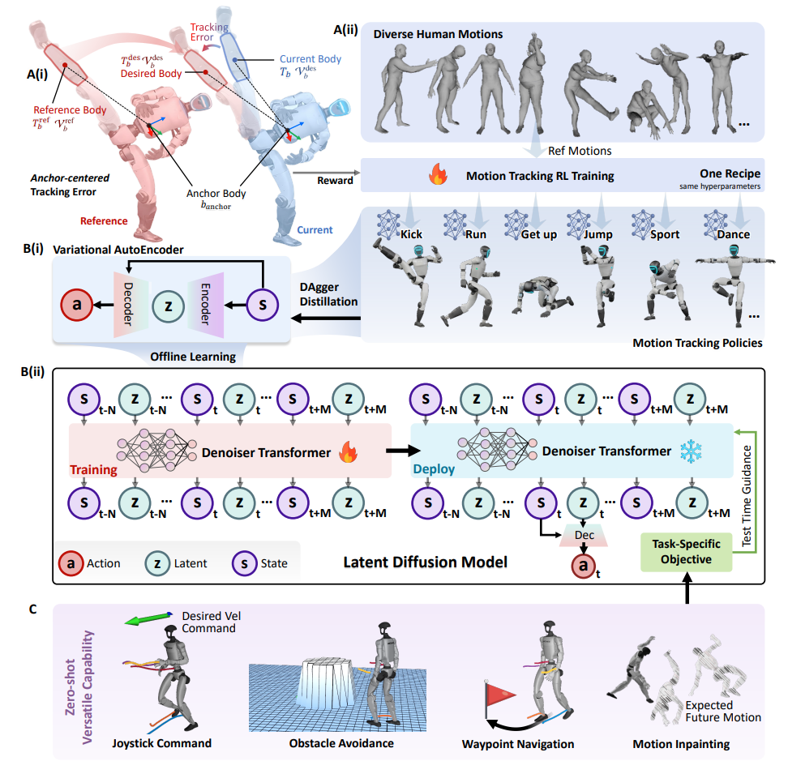
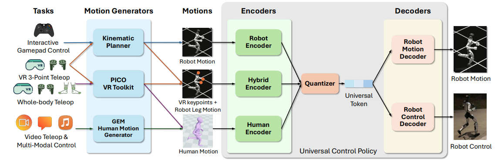

> 阅读本文前，建议先阅读前置文章 [WBC.md](WBC.md)。

本文是「WBC 经典论文」系列，分别拆解三篇代表性的全身控制工作：**BeyondMimic**、**SONIC** 与 **MimicLite**。BeyondMimic 走「先训练技能专家、再蒸馏成通用控制器」的路线，SONIC 走「统一运动表示」的路线，MimicLite 则聚焦于让一个标准 RL Motion Tracking 系统训练得快、跟踪得准，并适配真实机器人。

## BeyondMimic

### 整体思路



BeyondMimic 的思路可以概括为：**先把人类动作拆成一个个「技能专家」，再用生成模型把它们蒸馏成一个通用控制器，从而在没有参考动作的情况下自主生成全身运动（Whole-Body Control, WBC）。**

整个过程分为两阶段的训练，再加一阶段的真机推理，共三步。

**第一步 · 训练技能专家（Stage 1）**

- **Human Motion → Retargeting**：把人类动作重定向到机器人上，得到行走、跑步、翻滚等参考动作。
- 为每个动作训练一个 **RL 跟踪策略**（RL Policy 1 / 2 / 3）。

**第二步 · 蒸馏为通用控制器（Stage 2）**

- **Conditional VAE（Multi-policy Distillation）**：把多个 Teacher 策略压缩为「统一 Decoder + 运动 Latent」。
- **Rollout**：让 VAE 在仿真中执行，收集真实的 State-Latent 轨迹。
- **Diffusion**：学习 State-Latent 轨迹的分布，学会生成连续、合理的未来运动序列。

**第三步 · 真机推理（无需 Reference Motion）**

- **Task Goal + Guidance → Diffusion**：根据任务目标生成符合要求的未来 State-Latent 轨迹。
- **VAE Decoder → Setpoint → PD → Robot**：结合最新机器人状态，实时执行并反馈。

### 先建立直觉：为什么要分两个阶段？

**Stage 1 解决「怎么动」的问题。** 假设我们有人类侧手翻的 Motion Capture 数据，即使通过 Retargeting 把人体姿态映射到机器人关节，得到的也只是一段运动学上定义好的参考轨迹，并不能保证机器人真的能执行。例如：

- 机器人与人类的质量分布不同；
- 电机可输出的力矩有限；
- 机器人必须与地面接触才能获得起跳冲量；
- 落地时必须吸收冲击、控制角动量；
- 关节运动存在惯性，不能瞬间从一个位置跳到另一个位置。

因此 Stage 1 让 RL Policy 学习在上述物理约束下尽量跟踪参考动作。

**Stage 2 解决「怎么组合」的问题。** 如果 Stage 1 只学会了固定的侧手翻、跑步、踢腿，仍然存在一个隐患：机器人会模仿，不代表它会自主选择、衔接和组合技能。因此论文进一步利用 VAE 和 Latent Diffusion 学习可生成的运动先验，并在推理时通过 Cost Guidance 实现速度控制、导航、避障、动作补全与切换。

一句话总结：**Stage 1 需要 Reference Motion 才知道该做什么；Stage 2 的目标是在没有 Reference Motion 时，仅凭任务目标自主生成运动。**

---

### Stage 1：Motion Tracking

#### 1. Anchor-centered Tracking（锚点居中的跟踪）

假设机器人正在沿着 \(x\) 轴向前走，参考轨迹为：

\[
p_{\mathrm{root}}^{\mathrm{ref}}=(2.0,0,0.8)
\]

但实际机器人受到外部扰动：

\[
p_{\mathrm{root}}=(2.2,0,0.8)
\]

也就是机器人已经向前偏移了 \(0.2\) 米。

如果所有身体节点继续使用原始世界坐标下的参考位置，控制器就会不断尝试让身体回到原轨迹，可能诱发不必要的后退、急促转向甚至摔倒。实际上，我们往往更希望机器人允许整体平移，却仍然保持自然的身体动作。

假设原始参考中，右手相对于躯干的位置是：

\[
p_{\mathrm{hand}}^{\mathrm{ref}}
-p_{\mathrm{root}}^{\mathrm{ref}}
=(0.2,-0.3,0.1)
\]

我们就可以把这个相对位置重新放到当前机器人附近。论文使用的转换更精细：允许水平平移与 Yaw 旋转对齐，但保留参考中的高度。其核心公式为：

\[
\boxed{
p_b^{\mathrm{des}}
=p_\Delta+
R_\Delta
(p_b^{\mathrm{ref}}-p_{\mathrm{anchor}}^{\mathrm{ref}})
}
\]

其中：

\[
p_\Delta=
\begin{bmatrix}
p_{\mathrm{anchor},x}\\
p_{\mathrm{anchor},y}\\
p_{\mathrm{anchor},z}^{\mathrm{ref}}
\end{bmatrix}
\]

\[
R_\Delta
=R_z\left(
\operatorname{yaw}
(R_{\mathrm{anchor}}
(R_{\mathrm{anchor}}^{\mathrm{ref}})^\top)
\right)
\]

于是，其他身体节点的 Desired Pose 不再是机械地固定在原来的世界坐标中，而是跟随机器人当前的水平位置和朝向调整。

但请注意：论文并没有简单地删除全部全局信息。Anchor 本身仍保留参考姿态，策略观察中也保留 Anchor Error，以便在需要时进行全局漂移修正。

这里涉及一个有意思的平衡：

- **完全跟踪世界坐标**：参考精确，但抗扰动能力弱。
- **完全使用局部姿态**：鲁棒性强，但可能失去整体位置和高度约束。
- **BeyondMimic**：允许部分全局漂移，同时保留重要的姿态与高度信息。

这就是一种针对 Motion Tracking 的不变性设计。

#### 2. Reward 设计

论文的任务奖励只有四个核心部分：

\[
r_{\mathrm{task}}=
r_p+r_R+r_v+r_\omega
\]

对于每一种误差 \(s\)，定义：

\[
\bar e_s=
\frac{1}{|\mathcal B_{\mathrm{target}}|}
\sum_{b\in\mathcal B_{\mathrm{target}}}
\|e_{s,b}\|^2
\]

\[
r_s=\exp\left(-\frac{\bar e_s}{\sigma_s^2}\right)
\]

这里 \(\mathcal B_{\mathrm{target}}\) 是被选择用于 Tracking 的身体节点集合，不一定包含机器人所有 Link。

四项的 \(\sigma_s^2\) 各不相同，需要调参。这个设计的优点是各项奖励被压缩到相近的数值范围，不需要让位置误差和速度误差使用同一个原始物理尺度。

除了任务奖励，论文还引入三项正则化：

\[
\boxed{
r=r_{\mathrm{task}}
-\lambda_l r_{\mathrm{limit}}
-\lambda_s r_{\mathrm{smooth}}
-\lambda_c r_{\mathrm{contact}}
}
\]

其中：

**Joint Limit Penalty（关节限位惩罚）**

\[
r_{\mathrm{limit}}=
\sum_j\left[
\max(l_j-\theta_j,0)+
\max(\theta_j-u_j,0)
\right]
\]

防止实际关节状态越过软限制。

**Action Smoothness Penalty（动作平滑惩罚）**

\[
r_{\mathrm{smooth}}
=\|a_t-a_{t-1}\|^2
\]

抑制控制信号剧烈变化。

**Undesired Contact Penalty（非预期接触惩罚）**

对非预期自碰撞超过阈值的身体节点计数，论文采用 1 N 的自接触力阈值。

对应的惩罚权重绝对值分别为 10、0.1、0.1。论文正文与附录采用了不同的加减号约定，复现时应按照代码的实际符号定义。

#### 3. Observation：机器人看到了什么

Policy 的输入为：

\[
\boxed{
o_t=[
\psi_t,\,
e_{\mathrm{anchor},t},\,
\mathcal V_{\mathrm{imu},t},\,
\theta_t-\theta^0,\,
\dot\theta_t,\,
a_{t-1}
]
}
\]

逐项解释如下：

| 输入 | 意义 |
| --- | --- |
| \(\psi_t\) | 参考关节位置和速度，提供当前动作阶段信息 |
| \(e_{\mathrm{anchor}}\) | Anchor 位置和姿态误差 |
| \(\mathcal V_{\mathrm{imu}}\) | IMU 坐标系中的线速度和角速度 |
| \(\theta-\theta^0\) | 相对默认位置的关节角度 |
| \(\dot\theta\) | 关节速度 |
| \(a_{t-1}\) | 上一个时间步的 Action |

这里有两个值得注意的点。

第一，Reference Joint States 只作为动作进度信息，并不直接作为需要由关节 PD 精确跟踪的目标，真正控制 Action 的是策略自己输出的 Setpoint。

第二，论文没有给 Actor 使用额外的历史堆叠，而是只输入上一时刻的 Action。

#### 4. 底层控制：PD、阻抗与电机动力学

这是论文最能体现其机器人控制特色的部分。

**Action 究竟是什么？**

论文定义：

\[
\boxed{
\theta^{\mathrm{sp}}=\theta^0+\alpha\odot a_t
}
\]

其中：

- \(a_t\)：神经网络的输出；
- \(\theta^0\)：关节默认位置；
- \(\alpha\)：每个关节对应的 Action Scale；
- \(\theta^{\mathrm{sp}}\)：发送给低层电机控制器的位置 Setpoint。

低层 PD 控制器再计算：

\[
\boxed{
\tau_t=
K_p(\theta^{\mathrm{sp}}-\theta_t)
-K_d\dot\theta_t
}
\]

这是目标速度为零的常见形式；真实执行时还受到电机驱动和力矩限制。

将两个公式合并：

\[
\tau_t=
K_p(\theta^0-\theta_t)
+K_p(\alpha\odot a_t)
-K_d\dot\theta_t
\]

可以发现：神经网络虽然输出的是 Position Setpoint，但它实际上通过改变 Setpoint 来间接调节电机力矩。所以这里的 Action 更接近一种隐式 Torque Control 接口，而不是要让每个关节严格到达某个固定位置。

**为什么不用直接输出 Torque？**

直接输出力矩也是可行的强化学习控制方式：

\[
\tau_t=\pi(o_t)
\]

但直接 Torque Control 对电机模型、延迟和系统频率更加敏感，也需要更细致地处理硬件安全与执行接口。PD 控制器则提供了一个经过结构化设计的底层反馈机制。

例如，当机器人受到推力、关节偏离 Setpoint 时，PD 会立即产生恢复力矩，而不必完全等待上层 Policy 重新计算。这样就形成了两个不同层次的反馈：

\[
\text{Policy-level feedback}
+
\text{Joint-level PD feedback}
\]

在 BeyondMimic 中，策略必须学习怎样利用这个 PD 闭环，而不是假设位置 Setpoint 一定能够被执行。

**Armature 是什么？**

很多首次接触 Isaac Sim 或 MuJoCo 的同学会在机器人的配置文件中看到 `armature`，却不知道它到底是什么。它并不是一个普通的数值稳定性超参数，而是代表由电机转子和传动机构反映到关节侧的附加惯量。

假设电机经过减速器驱动关节，减速比为 \(N\)：

\[
\boxed{
I_{\mathrm{armature}}
=N^2I_{\mathrm{rotor}}
}
\]

再考虑关节所驱动的连杆惯量：

\[
I_{\mathrm{effective}}
\approx I_{\mathrm{link}}+
I_{\mathrm{armature}}
\]

这是单轴附近的简化表达，真实多关节系统中还会随姿态出现耦合。

如果仿真里将 Armature 设置成 0，就会高估机器人对相同力矩的加速能力。根据：

\[
\tau=I\ddot\theta
\]

相同的 \(\tau\) 下，惯量被低估，仿真得到的 \(\ddot\theta\) 就会过大。这样训练出来的策略，可能学会了在真实机器人上根本无法完成的快速关节加速。

BeyondMimic 的消融实验也验证了这一点：忽略 Armature 会造成过大的关节加速度、动作过冲和自碰撞。论文 Supplementary Table S4 中，对于踝关节和一些末端关节，电机反射惯量甚至占有效惯量的绝大部分。

**为什么论文倾向于较低阻抗？**

较高的 \(K_p\) 意味着关节在偏离 Setpoint 时会产生更大的恢复力矩，直观上似乎越高越好——能更准确地跟踪参考位置。但在机器人上并非如此。

当机器人落地时，关节必须吸收短时间的冲击。如果关节刚度过大，就可能产生剧烈的恢复力矩，使冲击直接转化为电机和齿轮箱的负担。同时，高增益还可能放大传感器噪声，诱发高频振荡。

---

### Stage 2：Latent Diffusion 如何实现通用 WBC

第一阶段解决了一个问题：让机器人学会准确、稳定地复现不同的人类动作。但 Stage 1 有一个根本限制：每个 Motion Tracking Policy 本质上还是在跟踪自己对应的参考动作，并不是统一的任务控制器。

论文强调，Stage 1 的 one-recipe-fits-all 是指所有动作使用同一套训练配方和超参数，并不意味着只训练一个统一 Policy。真正把这些运动技能统一起来的是 Stage 2。

#### 1. VAE 蒸馏

BeyondMimic 首先训练 Conditional VAE，把不同动作策略压缩到统一的 Latent Space。不过它没有直接将原始 Action 输入 Encoder——由于 PD Setpoint 对物理状态非常敏感，原始 Action 分布可能存在较大的不规则性，因此作者选择：

\[
z_t=\mathcal E(\psi_t,e_{\mathrm{anchor},t})
\]

Encoder 输入参考动作信息，学习动作意图 Latent。Decoder 则使用：

\[
\boxed{
\hat a_t=
\mathcal D(
z_t,\,
g_t,\,
\mathcal V_{\mathrm{imu},t},\,
\theta_t,\,
\dot\theta_t,\,
a_{t-1}
)
}
\]

其中 \(g_t\) 是机器人坐标系下的投影重力向量。

这里的逻辑非常重要：

\[
\underbrace{z_t}_{\text{What to do}}
+
\underbrace{\text{Proprioception}}_{\text{Current physical state}}
\longrightarrow
\underbrace{a_t}_{\text{How to execute}}
\]

Latent 主要表示动作意图，而 Decoder 结合当前物理状态进行闭环控制。因此，相同的 Latent 在机器人受到不同扰动时，可以被 Decoder 转化为不同的实际 Action，这相比单纯生成固定的关节动作序列具有明显优势。

VAE 使用动作重建损失与 KL 正则训练，并通过 DAgger 减少 Student Policy 自身执行时产生的状态分布偏移：

\[
\mathcal L_{\mathrm{VAE}}
=
\mathbb E[\|\hat a-a^{\mathrm{teacher}}\|^2]
+
\beta D_{\mathrm{KL}}(q(z|\cdot)\|\mathcal N(0,I))
\]

#### 2. 为什么 Diffusion 要同时生成 State 和 Action Latent

这是 Stage 2 最核心的架构创新。

我们熟悉的 Action Diffusion 通常生成未来动作：

\[
p(a_{t:t+H}\mid s_t)
\]

但是机器人接收的任务目标往往定义在 State Space 中。例如：

- 我希望机器人以 2 m/s 向前跑；
- 我希望机器人走到指定位置；
- 我希望机器人绕过障碍物。

这些要求都很难直接转化为某个关节 Action 的数值。因此 BeyondMimic 不是只生成 Action，而是联合生成：

\[
\boxed{
\tau=
[
s_{t-N},z_{t-N},
\dots,
s_t,z_t,
\dots,
s_{t+H},z_{t+H}
]
}
\]

这里 \(z\) 对应 VAE 中可解码为 Action 的 Latent。模型既能预测机器人未来的 State，也能生成产生相应运动的控制 Latent。当我们希望机器人以某个速度运动时，可以直接对预测出来的未来速度定义 Cost，而不是尝试直接约束复杂的关节控制命令。

论文使用 Transformer 作为 Denoising Backbone，训练目标可以简化写成：

\[
\mathcal L_{\mathrm{diff}}
=
\mathbb E[
\|D_\phi(\tau^k,k)-\tau^0\|^2
]
\]

训练数据来自蒸馏后的 VAE Policy 在仿真中的 Rollout，包含真实经历的 State 与对应 Latent。这种联合建模让模型学习的是运动轨迹分布中的状态—动作关联。

#### 3. Guided Diffusion：如何在测试时实现新任务

假设我们希望机器人以目标速度 \(v^*\) 运动，可以对预测轨迹定义：

\[
G_{\mathrm{velocity}}(\tau)
=
\frac12\sum_{i=0}^{H}
\|v_{t+i}-v^*\|^2
\]

通过贝叶斯规则，Task-conditioned Score 可以写成：

\[
\nabla_\tau\log p(\tau\mid\text{task})
=
\nabla_\tau\log p(\tau)
-
\nabla_\tau G(\tau)
\]

实际执行时，还需要使用适当的 Guidance Scale，并根据具体的采样器设计 Guidance 更新。

这里最值得理解的是两个梯度各自负责什么：

\[
\underbrace{\nabla_\tau\log p(\tau)}_{\text{Motion Prior}}
\]

代表模型从真实可执行运动数据中学到的运动分布偏好；

\[
\underbrace{-\nabla_\tau G(\tau)}_{\text{Task Guidance}}
\]

代表当前任务希望轨迹向哪个方向变化。

二者共同作用，就可能得到既符合动作分布、又能完成新任务的轨迹。

#### 4. 为什么这可以看成一种 Generative MPC

传统 Model Predictive Control（MPC）会反复执行：

\[
\text{预测未来}
\rightarrow
\text{优化控制}
\rightarrow
\text{执行当前动作}
\rightarrow
\text{重新规划}
\]

BeyondMimic 的 Diffusion Controller 也具备类似结构：

\[
\text{预测 State-Latent Trajectory}
\rightarrow
\text{Guidance}
\rightarrow
\text{Decode Action}
\rightarrow
\text{重新生成}
\]

因此，可以将其理解为一种以 Learned Motion Prior 为基础的生成式滚动时域控制方法。

论文使用未来 16 步、25 Hz 的设置，对应约 0.64 秒的预测范围。另外，它仍然利用异步执行来处理 Diffusion 的推理延迟：GPU 负责生成轨迹，轻量 VAE Decoder 在 CPU 上结合最新观测同步输出 Action，从而减少慢速 Diffusion 预测与实时机器人状态之间的不一致。

### 小结

回顾整篇论文的主线：

- **Stage 1**：用 RL 训练多个运动跟踪策略，让机器人学会在物理约束下准确、稳定地复现人类动作；
- **Stage 2**：用 VAE 把这些策略蒸馏到统一的 Latent Space，再用 Diffusion 学习 State-Latent 轨迹分布，配合 Guidance 在测试时完成速度控制、导航、避障等新任务。

一句话概括：**Stage 1 让机器人「会做」，Stage 2 让机器人「会用」。** 正因如此，Stage 1 还需要 Reference Motion，而 Stage 2 可以脱离参考动作、仅凭任务目标自主生成运动。

BeyondMimic 实现了从 Motion Imitation 到 Task-directed Motion Generation 的重要跨越，但仍然不是通用的自然语言驱动机器人控制系统。它的 Generalization 主要来自一个可复用的运动先验，以及推理时可以替换、组合的优化目标，而不是模型已经学会了任意任务的语义。

---

## SONIC



与 BeyondMimic 不同，SONIC 不采用「多个 RL Teacher → VAE 蒸馏 → Diffusion」的路线，而是直接构建统一的 **Encoder–Quantizer–Decoder** 架构，并将它与 PPO 联合训练。

### 整体思路

根据论文 Figure 6 简化，SONIC 的架构可以分成三层：

- **上层 · 三种运动指令来源**
  - **Robot Motion（机器人运动）**：关节位置、速度 → Encoder \(E_r\)；
  - **Human Motion（人体运动）**：SMPL 人体姿态 → Encoder \(E_h\)；
  - **Hybrid Motion（混合运动）**：上肢关键点 + 下肢轨迹 → Encoder \(E_m\)。
- **中层 · FSQ Quantizer**：把三种输入统一量化为 **Universal Motion Tokens \(z\)**，即统一的 64 维量化运动表示。
- **下层 · 两个 Decoder**
  - **Control Decoder**：Token + 本体观测 → 29 维关节 Action → PD；
  - **Motion Decoder**：Token → Robot Motion Reconstruction。

其中 Control Decoder 由 PPO 训练，Motion Decoder 提供辅助重建监督；两个分支并不是两个独立的 RL Policy。

### 三种输入，一个统一表示

三种输入对应三种不同的运动来源：

- **Robot Motion**：已有机器人关节角度和速度，直接描述机器人未来应该怎样移动；
- **Human Motion**：只有人体 SMPL 姿态，包含人体骨骼的三维位置，和机器人关节空间并不一致；
- **Hybrid Motion**：操作者只控制头部和双手，下半身运动由规划器生成，此时参考中同时存在人体关键点和机器人关节状态。

无论来源是什么，最终都要进入同一个 Token 空间。

**为什么不用普通 VAE 的连续 Latent？**

主要考虑两个方面。

第一，FSQ 不需要维护 VQ-VAE 那种可学习的 Codebook，可以减少 Codebook Collapse 问题。

第二，离散、结构化的 Token 可以作为其他模型的输出接口，特别是 VLA：

\[
\text{Image + Language}
\longrightarrow
\text{VLA}
\longrightarrow
z
\longrightarrow
\text{SONIC}
\]

VLA 不再需要预测复杂的人体或机器人各关节姿态，而只需要输出一个被 SONIC 训练约束过的运动表示。不过，这并不意味着预测任意 Token 都保证安全，只是该表示更容易学习，也更接近 SONIC 的有效运动先验。

### 两个 Decoder 为什么缺一不可

**Control Decoder**

\[
\boxed{
a_t=D_c(z_t,s_t^{p})
}
\]

这里 \(s_t^p\) 是机器人当前的 Proprioceptive State。Decoder 输出 29 维关节目标，由 PD 控制器转化为关节力矩。它和 BeyondMimic 的 VAE Decoder 很相似：同一个 Motion Latent 对应的实际 Setpoint，会根据机器人当前状态变化——例如机器人身体已经前倾，Decoder 就不必输出与正常直立状态完全相同的 Setpoint。

**Motion Decoder**

\[
\boxed{
\hat g_r=D_r(z)
}
\]

它并不直接驱动电机，而是用于从 Token 重建 Robot Motion Reference。

既然 Control Decoder 已经能够执行动作，为什么还需要 Motion Decoder？因为仅靠 PPO，Encoder 学到的 Latent 只需有助于获得高 Reward，而未必具备清晰、稳定的运动信息结构。例如，两个表示上相似的 Motion Reference 可能被编码成很不相同的 Latent，只要最终能得到较高的 Tracking Reward，PPO 本身并不一定惩罚这种不一致。

Motion Reconstruction 给 Token 增加直接监督：

\[
\mathcal L_{\mathrm{recon}}
=\|D_r(z)-g_r\|^2
\]

这使 Latent 不仅有利于控制，还要保留可以重建参考运动的信息，对于跨输入形式对齐、下游运动生成以及 VLA 学习都很重要。

因此：

- **Control Decoder** 保证 Token 有控制价值；
- **Motion Decoder** 约束 Token 保留运动信息。

二者共同形成有物理执行能力的 Motion Representation。

### SONIC 怎样训练

总损失为：

\[
\boxed{
\mathcal L
=
\mathcal L_{\mathrm{PPO}}
+
\mathcal L_{\mathrm{recon}}
+
\mathcal L_{\mathrm{token}}
+
\mathcal L_{\mathrm{cycle}}
}
\]

#### 1. PPO Loss：学习真正的物理控制能力

与 BeyondMimic 类似，SONIC 使用 PPO 训练 Tracking Policy：

\[
a_t=D_c(Q(E(g_t)),s_t^p)
\]

然后经过 PD 和动力学仿真器：

\[
\tau_t=K_p(q_t^{\mathrm{des}}-q_t)-K_d\dot q_t
\]

\[
s_{t+1}=F(s_t,\tau_t)
\]

利用 Reward 更新策略。

因此，虽然 SONIC 的外部形式很像 Encoder-Decoder 模型，但它不是普通的监督学习 Action Predictor：Control Decoder 输出的 Action 不来自人工标注，而是通过 RL 与物理环境交互学习的。同时 PPO 的梯度会经过 FSQ 的 Straight-through Estimator 传回 Encoder，使运动表示本身也能被控制目标塑造。

#### 2. Reconstruction Loss：约束表示包含运动信息

对于三个 Encoder：

\[
\mathcal L_{\mathrm{recon}}
=
\|D_r(z_r)-g_r\|^2
+
\|D_r(z_h)-g_r\|^2
+
\|D_r(z_m)-g_r\|^2
\]

注意，三个分支的重建目标都是 Robot Motion \(g_r\)。这意味着当输入是 Human Motion 时，系统也必须从 Human Token 重建对应的 Robot Motion，所以这在一定程度上起到了 Learned Retargeting 的作用。不过它在训练阶段依赖配对好的人体与机器人运动数据，不代表完全不需要离线 Retargeting。

#### 3. Token Alignment Loss：让不同 Encoder 学会同一种表示

\[
\boxed{
\mathcal L_{\mathrm{token}}
=
\|z_r-z_h\|^2
+
\|z_r-z_m\|^2
+
\|z_m-z_h\|^2
}
\]

这个公式非常直接：对于同一个动作，不管输入来自机器人、人体还是 VR，都希望编码到相近的 Token。

#### 4. Cycle Consistency Loss：强化跨 Embodiment 一致性

论文定义：

\[
\boxed{
\mathcal L_{\mathrm{cycle}}
=
\|E_r(D_r(z_h))-z_r\|^2
}
\]

其过程为：

\[
\text{Human Motion}
\rightarrow z_h
\rightarrow\text{Robot Motion}
\rightarrow\hat z_r
\]

最后要求：

\[
\hat z_r\approx z_r
\]

### Generative Kinematic Motion Planner：SONIC 怎么自主生成运动

#### Planner 和 Tracking Policy 的分工

```
用户意图 User Intent
（速度、方向、步态、姿态目标、动作风格）
        ↓
Generative Kinematic Planner
（根据当前姿态和目标关键帧，生成中间运动）
        ↓
Kinematic Motion Reference
        ↓
Universal Tracking Policy
（Motion Encoder → FSQ Token → Control Decoder）
        ↓
PD → Dynamics → Real Robot
```

核心区别：

- **Planner** 负责生成「应该怎样运动」的参考轨迹；
- **Tracking Policy** 负责把参考轨迹变成符合真实动力学的控制行为。

SONIC 使用 Generative Model 学习：

\[
\boxed{
p(q_{1:T-1}\mid q_{\mathrm{start}},q_{\mathrm{target}})
}
\]

即给定动作起点和终点，生成自然、连续的中间运动，这称为 **Motion In-betweening**。论文在训练时，从数据集中抽取 0.8–2.4 秒的运动片段，并将首尾关键帧作为条件，学习生成中间轨迹。

#### 基于 Masked Token Prediction 的生成方式

SONIC 的 Kinematic Planner 主要采用 Masked Token Prediction，而不是 BeyondMimic 那种连续轨迹 Guided Diffusion。

它首先把连续运动编码为离散的 Motion Latent Token Sequence：

\[
z_{1:T/4}=\operatorname{Enc}(q_{1:T})
\]

这里做了时间维度上 4 倍下采样。

然后给定起始关键帧和目标关键帧，把中间 Token 先 Mask 掉，再逐步补全：

```
Step 1 · 初始 Mask          S  ?  ?  ?  ?  ?  T
Step 2 · 预测高置信度 Token  S  ?  A  ?  B  ?  T
Step 3 · 逐步补全整个序列    S  C  A  D  B  E  T
```

其中 S/T 表示已知的起始和目标关键帧，A–E 是示意性的预测 Token，真实模型使用迭代 Masked Token Prediction 和置信度调度。

具体来说，网络预测：

\[
P(z_i\mid z_{\mathrm{visible}},q_{\mathrm{start}},q_{\mathrm{target}})
\]

每次选择一部分高置信度 Token 确定下来，然后继续推测其余未知 Token，直到整段序列完成，再将 Token 解码为连续运动。这和 MaskGIT 一类的生成思想很接近。

注意这里有两套不同的 Token 表示：

- **Planner 内部的 Motion Token**：用于生成连续的运动学轨迹；
- **Universal Control Policy 的 FSQ Token**：用于将不同输入映射到统一的物理控制接口。

不能因为两者都叫 Token，就认为它们是同一个 Latent Space。

### SONIC 和 VLA 如何结合

SONIC 把 Universal Motion Token 作为 VLA 的 Action Space。论文展示的 Whole-body VLA 使用：

\[
\boxed{
a_{\mathrm{VLA}}
=
[z_{\mathrm{SONIC}},q_{\mathrm{hands}}]
}
\]

其中：

\[
z_{\mathrm{SONIC}}\in\mathbb R^{64}
\]

\[
q_{\mathrm{hands}}\in\mathbb R^{14}
\]

所以最终是 78 维 Action 表示。这里的 14 维控制双手，64 维 Token 则负责剩余的全身运动控制。

VLA 不直接预测电机 Setpoint，而是预测一种可由 SONIC Decoder 执行的运动意图：

\[
\boxed{
\text{VLA}
\rightarrow
\text{Motion Token}
\rightarrow
\text{SONIC Control Decoder}
\rightarrow
\text{PD}
}
\]

这样，VLA 主要学习怎样选择和组织全身运动，而实际的动力学控制交由预训练好的 SONIC 承担。这非常接近分层控制：

- **High-level VLA**：负责语义理解和任务决策；
- **Low-level SONIC**：负责运动执行和本体反馈。

### 小结

如果说 BeyondMimic 是「先训练技能专家、再蒸馏成通用控制器」，那么 SONIC 则是「直接从统一的运动表示出发，用一个 Encoder–Quantizer–Decoder 架构贯穿三种输入」。它把「会做动作」的控制能力和「保留运动信息」的表示能力同时学进一个 Token 空间，并让这个空间成为 Planner 和 VLA 都可以对接的接口。

两篇论文放在一起看，正好代表了 WBC 的两条路线：一条从模仿走向生成，一条从表示走向统一。

## MimicLite

### 整体思路

MimicLite 的核心研究取舍很明确：尽可能让一个标准的 RL Motion Tracking 系统训练得快、跟踪得准，并且适合真实机器人使用。

它的基础训练链路非常直接：

```
Retargeted Robot Motion Dataset
（Root Pose、Joint Position、Body Pose、Velocity）
        ↓
Reference Command + Robot Observation
（参考动作的前后时刻 + 当前本体状态历史）
        ↓
PPO Actor（MLP）
（根据参考运动和物理状态，预测 Joint Position Action）
        ↓
Action Processing + Joint Position Control
（Action Scaling、Delay、Smoothing → Motor Setpoint）
        ↓
MuJoCo / Isaac Lab Physics
（更新机器人姿态、接触力、关节速度等）
        ↓
Tracking Reward → PPO Update
（位置、姿态、速度、关节误差与物理正则化）
```

这和 BeyondMimic Stage 1 的基本范式一致：从参考动作出发，用 PPO 训练一个跟踪策略。区别在于 MimicLite 把重心放在工程细节上，通过下面几个设计让系统更快、更稳、更贴近真实机器人。

### 关键设计

#### 1. Reference 时间窗口更短

MimicLite 不仅提供未来 Motion Reference，还提供少量过去的 Reference，且最远未来参考时刻为 0.08s（SONIC 为 0.9s）。

#### 2. Action Delay

训练中随机设置动作延迟，使 Policy 适应控制指令不能立即作用于真实机器人的情况。

#### 3. Action Smoothing

使用一个一阶更新：

\[
\boxed{
\bar a_t
=(1-\beta)\bar a_{t-1}+\beta a_{t-d}
}
\]

其中：

- \(a_{t-d}\) 是延迟后的 Action；
- \(\beta\) 控制新 Action 的权重；
- \(\bar a_t\) 是实际用于产生 Setpoint 的平滑 Action。

#### 4. Windowed Root Displacement Reward

当前公开代码里有一个值得注意的设计：`windowed_root_displacement_exp`。

定义实际 Root 和参考 Root 在水平面的误差：

\[
e_t=p_{xy,t}-p_{xy,t}^{\mathrm{ref}}
\]

再计算一个时间窗口内误差的变化：

\[
\boxed{
\Delta e_t=e_t-e_{t-H}
}
\]

展开：

\[
\Delta e_t=
(p_{xy,t}-p_{xy,t-H})
-
(p_{xy,t}^{\mathrm{ref}}-p_{xy,t-H}^{\mathrm{ref}})
\]

这实际上是在比较：过去一段时间里，机器人真实发生的水平位移，是否与参考动作要求的水平位移一致。当前默认配置使用 \(H=200\) 个控制步，以 50 Hz 计相当于约 4 秒。

此外，这项误差还结合世界坐标系下的 Root 高度误差：

\[
e_t^{\mathrm{root}}
=
\sqrt{
\|\Delta e_t\|^2+
(z_t-z_t^{\mathrm{ref}})^2
}
\]

再计算指数奖励：

\[
r_{\mathrm{root}}
=
\exp\left(
-\frac{e_t^{\mathrm{root}}}{\sigma}
\right)
\]

这里的 \(\sigma\) 在默认配置中为 0.3。

这个设计相当巧妙。如果机器人只是受到一次水平位置扰动，然后恢复了正确运动速度，那么它并不会永远因为那次水平平移而受到同样强烈的惩罚；但如果机器人持续走得比参考动作慢，位移误差就会逐渐增大。因此，它不是严格的绝对世界坐标跟踪，而是长时间窗口内的位移跟踪，加上绝对高度约束。

这一点与 BeyondMimic 的 Anchor-centered Tracking 有一定思想联系：都试图在参考动作精度与一定程度的全局漂移容忍之间取得平衡，不过两者采用的坐标处理和 Reward 设计并不相同。

#### 5. Tracking Reward

根据当前默认配置，Tracking Reward 大致包含：

\[
r_{\mathrm{tracking}}
=
r_{\mathrm{root}}
+r_{\mathrm{body}}
+r_{\mathrm{joint}}
+r_{\mathrm{arm}}
\]

各部分进一步拆成：

| Reward | 作用 |
| --- | --- |
| Root Position / Orientation | 跟踪整体位置变化和身体方向 |
| Root Linear / Angular Velocity | 跟踪根节点速度 |
| Body Local Position / Orientation | 让各身体节点复现正确姿态 |
| Body Linear / Angular Velocity | 保持动作动态一致 |
| Joint Position / Velocity | 提供额外关节空间约束 |
| Arm Keypoint Tracking | 提高手臂等关键节点跟踪精度 |

具体实现中，不同 Reward 使用指数函数，例如：

\[
r_i=\exp\left(-\frac{\bar e_i}{\sigma_i}\right)
\]

但不同误差的具体定义有所区别，不应直接认为所有项都使用相同的平方误差公式。

除了 Tracking Reward，还有动作正则化和物理相关项目：

\[
r_{\mathrm{total}}
=
r_{\mathrm{tracking}}+
r_{\mathrm{regularization}}
\]

涉及 Action Rate、Joint Velocity、Joint Limits、自碰撞、Feet Air Time 和 Survival 等。

### MimicLite-ROA：加入 Teacher–Student Adaptation 的 PPO

这里 ROA 的全称是 Regularized Online Adaptation。

简单来说是一种蒸馏：让 Teacher 使用更丰富的信息学习，然后让 Student 学会在信息不足时复现 Teacher 的控制能力。

### 小结

MimicLite 的价值不在于提出全新的架构，而在于把「快、准、真机可用」这三个目标落实到具体设计上：更短的前瞻窗口、显式建模的动作延迟与平滑、长时间窗口的位移奖励，以及一套面向真实机器人的 Reward 正则化。如果 BeyondMimic 回答的是「如何让机器人自主生成全身运动」，SONIC 回答的是「如何统一运动表示」，那么 MimicLite 回答的则是「如何让一个标准 Tracking 系统真正落地」。


